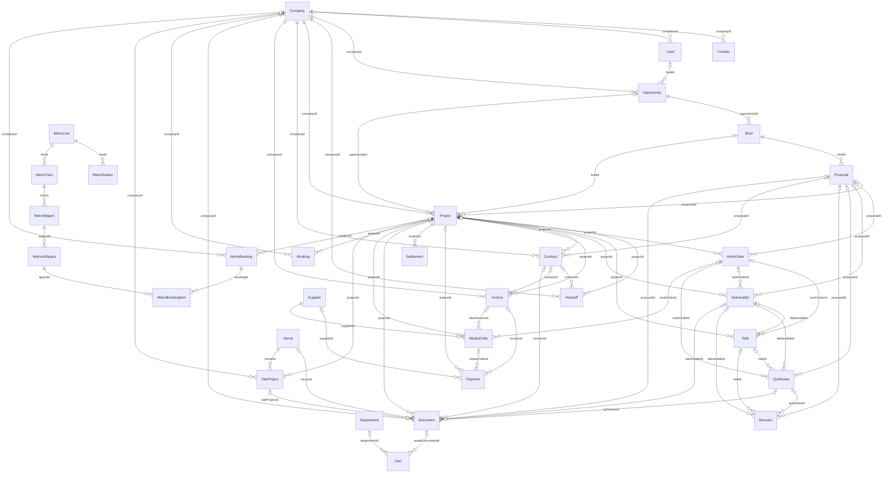

# System audit and data unification, 2026-11-18 (ADR-136)

The owner's brief of 2026-11-18 asked for a full architectural audit before any change, then a single source
of truth across modules, simpler screens, one search, consistent figures, tests and documentation. This file
is that audit, what was changed because of it, and what is left for the owner to decide.

## Executive summary

- The system already keeps one record per client, project and contract, and the core modules reach each
  other by key: 164 tables, 292 foreign keys (281 before this change). Every state change goes through one
  workflow engine with guards and an append-only history, and permissions and record visibility are decided
  in one place (`auth/visibility.ts`, `auth/grants.ts`).
- The audit found **six real integrity defects**, confirmed in code and, where possible, on the server's data
  (read-only queries, no writes). All six are fixed and covered by tests:
  1. Eleven id columns named another record without a foreign key. One of them was already broken locally:
     three units named managers who no longer exist.
  2. A lead converted with its bare state button got neither a client nor an opportunity. There are **4 such
     leads on the server.**
  3. Rejecting a deliverable from its own button left it waiting for a revision that was never made.
  4. Removing a person who managed a unit deleted them and left the unit pointing at no one.
  5. Deleting a client left its handoffs pointing at a client that no longer existed.
  6. Global search covered 7 kinds of record out of 15. Most lists showed a record's code but could not
     search by it.
- **Nothing was merged or deleted automatically.** The server holds records that look like duplicates:
  **7 groups of clients with the same name, 5 phone numbers on more than one person, and 36 open leads named
  like an existing client**. The new «بازبینی داده» page flags them for a person to decide.
- **Not deployed.** The change includes a database migration. The brief requires a backup and the owner's
  approval before production data changes, so the server is untouched.

## 1. Inventory

| | Count |
|---|---|
| Database tables (Prisma models) | 164 |
| Foreign keys | 292 (was 281) |
| API route files / lines | 59 / ~14,300 |
| Web pages | 44 |
| Permissions | 142 |
| Workflows (state machines) | lead, opportunity, brief, proposal, project, work order, task, deliverable, revision, change request, contract, invoice, site project, rental booking, and others (`packages/contracts/src/workflows.ts`) |
| API tests / web tests | 1,000 + 9 new / 468 |

### Modules and how they connect

| Module | Main records | Links to the client | Links to the project |
|---|---|---|---|
| CRM | Lead, Company, Contact, Opportunity, Activity | key (Lead.companyId set on conversion) | — |
| Account and proposal | Brief, Proposal, Handoff | through Opportunity; Handoff.companyId **(key added)** | Handoff.projectId |
| Delivery | Project, WorkOrder, Task, Deliverable, Milestone | Project.companyId | key |
| Quality | QcReview, Revision | through Project | Deliverable → Project |
| Commercial and finance | Contract, Invoice, Payment, Settlement | key | Settlement.projectId **(key added)** |
| Media and suppliers | MediaOrder, Supplier, OutsourceRequest, SupplierEvaluation | through Project | MediaOrder.workOrderId, SupplierEvaluation.projectId **(keys added)** |
| Venues and rentals | Venue, SiteProject, Booking | key (SetNull) | key |
| Metro | lines → stations, trains → wagons → spaces; MetroBooking | key (SetNull), or a typed name when there is no client record | key |
| People and units | User, Department, Team, Position | — | — |
| Files and notes | Document, Comment | key or kind+id | key or kind+id |
| History | AuditEvent, StateTransition | kind+id (kept after the record is deleted, on purpose) | kind+id |

### Core entity relations (generated from the schema)

## 2. Findings

| # | Finding | Evidence | Status |
|---|---|---|---|
| F1 | 11 id columns with no foreign key | DMMF scan; read-only server check found 0 orphans; local DB had 3 unit managers pointing at deleted people | **Fixed**: migration `20261118120000_missing_links` |
| F2 | Bare lead conversion made no client or opportunity | 4 converted leads with `companyId` null on the server, each with a same-named client | **Fixed**: guard `lead.throughConversion`; bare button hidden; existing 4 listed in data review |
| F3 | Deliverable rejected without its revision | `qc_reject` from the deliverable's buttons made no Revision row | **Fixed**: effect `ensureRevision` |
| F4 | Removing a unit manager left a dangling id | `hasHistory` follows foreign keys only; `Department.managerId` had none | **Fixed** by F1; data review lists units whose manager left (1 on the server) |
| F5 | Deleting a client left its handoffs behind | purge follows foreign keys; `Handoff.companyId` had none | **Fixed** by F1 (cascade) |
| F6 | Search covered 7 of 15 kinds; lists did not search by code | `routes/search.ts`, `lib/crud.ts` | **Fixed** |
| F7 | Client page missed leads, out-of-home projects, rentals and metro bookings | `/companies/:id/360` | **Fixed**: «سرنخ‌ها و خدمات دیگر» tab |
| F8 | Same-named clients, shared phones, leads named like a client | server, read-only: 7 / 5 / 36 | **Flagged**, not merged: `/data-review` |
| F9 | 120 more id columns without a key | polymorphic `entityType`/`entityId` (by design); `createdById`-style actor columns | **Deferred**: keying actor columns changes who can be deleted outright; owner's decision |
| F10 | Free-text names beside keys: Lead.companyName, MetroBooking.clientName, OutsourceRequest.proposedSupplierName, SiteAssignment.personName, ClientApproval.contactName | schema | **By design**: each is used only before a record exists or for an outsider with no record, and a key takes over once one exists |

## 3. What changed

- Database: 11 foreign keys (see ADR-136 for the delete rule of each).
- API: the `lead.throughConversion` guard; the deliverable revision effect; a wider `/search`; code search in
  every shared list; `services` in the client view; `GET /data-review` and
  `POST /data-review/leads/:id/link` (audited).
- Web: the leads list shows one conversion button, not two; search results open where the search says; a
  list opens already searching when reached with `?q=`; the client page's new tab; the «بازبینی داده»
  page under «بیشتر», with its guide entry.

## 4. Migration and deployment

1. On the server, `infrastructure/hivamis upgrade` takes a full database backup first (as every upgrade
   does), then applies the migration.
2. The migration adds constraints and rewrites nothing, except clearing a unit-manager id that names no
   existing person (0 such rows on the server on 2026-11-18). If any other column has a broken reference,
   the constraint fails, the migration rolls back and the old version keeps running.
3. After the upgrade: `SELECT count(*) FROM pg_constraint WHERE conname LIKE '%_fkey'` grows by 11; the
   admin's password fingerprint is unchanged; `/data-review` lists the flagged records.

**Rollback.** Restore the backup the upgrade printed (`infrastructure/hivamis restore --db FILE.dump --yes`), or, without losing newer
data, drop the 11 constraints by name and deploy the previous commit. No data needs restoring, because
nothing was rewritten.

## 5. Tests

- `apps/api/tests/096-data-unification.test.ts` (10 tests): bare conversion refused and form conversion links
  the client; a rejected deliverable gets exactly one revision; the database refuses a missing unit manager
  and holds the 11 keys; a removed manager stays as history and is flagged; search finds a lead by a phone in
  Persian digits and a client's person by name, and keeps to permissions; a list finds by code; the client
  page shows leads; same-named clients are flagged, not merged; linking a lead takes permission, is audited
  and happens once.
- Regression: API 980/980 and web 468/468 pass. Two timing tests (sign-in delay, quick menu) each failed once
  under full-suite load and passed on every rerun. Neither touches the changed code.
- Browser, on the local test copy: the data review page; search by a phone typed in Persian digits opens the
  client; the client's new tab links to the lead; the leads list opens already searching for the code.

## 6. Limitations and what is left

- **Not covered by this pass:** an end-to-end check of every dashboard figure against its source, and a load
  test. The brief asks for both. They need their own pass, measured on a copy of the server's data.
- The flagged records on the server (F8, and the 4 leads in F2) need a person who knows the clients.
- Keying the actor columns (F9) is ready to do once the owner agrees that removed people with any such row
  are kept, marked removed, rather than deleted outright.
